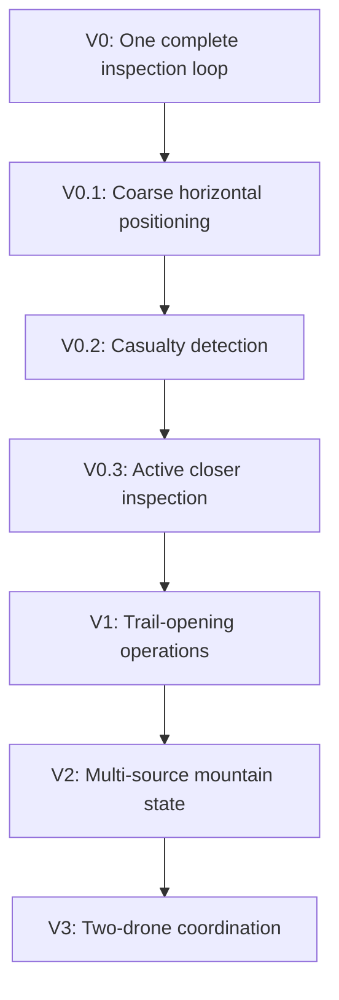

# SENTINEL Demo State Database Specification

**Document version:** 0.8  
**Status:** Historical parent baseline; non-authoritative for current V0
**Scope:** Historical orchestrator/rock-inspection design retained for compatibility and future releases

Document versions describe changes to this specification. Product/demo releases are labelled `V0`, `V0.1`, and so on in Section 14.

> **Current V0 authority note (2026-09-17):** This document is retained historical support. Its older MVP/V0 assignment, task/ranking, patroller, closer-observation and served-video requirements are not current V0 acceptance requirements. The current supervised V0 profile is defined by [`docs/superpowers/specs/2026-09-16-sentinel-v0-coherence-spec.md`](superpowers/specs/2026-09-16-sentinel-v0-coherence-spec.md) and WP0; V0 ends when the coordinator persists the zone-level perception result, which the UI renders read-only. Operator approval is reserved for proposed plans and future agentic actions, not database state. Existing contracts remain retained and are deferred rather than deleted.

## 1. Objective

Prove one small but complete agentic physical-AI loop:

```text
User text
   |
   v
Orchestrator agent
   |
   | dispatch_drone(section, mission envelope)
   v
Drone flight + visible video stream
   |
   v
Selected frame -> rock/pebble detection -> database
   |
   v
Agent resumes from detection event
   |
   | optionally inspect_closer(target)
   v
Agent creates task and assigns patroller
```

The historical MVP succeeds when a user can request an inspection in text, the agent dispatches a real drone inside an authorised mission envelope, a live image produces a stored rock/pebble detection, the agent proposes a patroller assignment, and the operator confirms it. This assignment completion criterion is superseded for current V0 by the coordinator-owned zone-result profile.

Moving slightly closer to confirm or improve a detection is a **stretch capability**, not part of the minimum success condition.

## 2. Explicit boundaries

### Must genuinely run

- Text message triggers the orchestrator.
- The orchestrator reads current state and calls typed tools.
- A real Tello is dispatched using a predefined, validated movement sequence.
- The operator can see the drone video stream.
- One or more selected frames are sent to the detector.
- Rock/pebble detection results are ingested into the database.
- The agent is resumed by a state-change event rather than by manually pasting results.
- The agent creates a task and proposes a patroller assignment through a tool.
- The operator confirms the proposed assignment before it becomes active.
- The event history shows what happened and in what order.

### May be simulated, but must be labelled

- Patroller identity, availability and section
- Auditorium-to-mountain section mapping
- Trail name and opening context
- Travel time or distance to the target
- Weather and other resort context, if shown

### Deferred from V0

- Casualty workflow
- Full trail-opening state machine
- Patroller mobile acknowledgement after operator confirmation
- Physical intervention and drone reinspection
- Multi-agent runtime
- Dynamic path planning
- Precise horizontal positioning
- Multi-drone formation or collision avoidance
- Long-term learning across demonstrations

## 3. Runtime architecture

Use a local coordinator with SQLite in WAL mode.

```text
                    +----------------------+
User/operator ----> | Coordinator API + UI | <---- visible video
                    +----------+-----------+
                               |
                        Orchestrator agent
                               |
                         typed tool calls
                               |
                    +----------v-----------+
                    | policy/tool gateway  |
                    +-----+-----------+----+
                          |           |
                    drone tool   patroller tool
                          |           |
                    Tello worker    database + approval
                          |           ^
                          +-> frames -+
                              |
                           detector
```

For two standard Tello drones, each drone remains attached to its own worker computer/Wi-Fi interface. The coordinator communicates with workers over a separate network. The MVP loop only requires one drone; the schema keeps `drone_id` so a second worker can be added without redesign.

The coordinator is the only database writer. Drone workers, the UI and the agent communicate through APIs/events rather than opening SQLite directly.

## 4. State ownership

The database separates three kinds of state.

### Factual state

Produced by deterministic ingestion:

- drone connection, battery and flight status
- an image was captured
- a detector returned a result
- a tool call succeeded or failed
- an assignment record was created

The agent cannot edit factual state directly.

### Agent state

Compact, inspectable orchestration memory:

- current goal
- current phase
- pending tool call
- target currently being evaluated
- next intended action
- retry count
- last processed event

This is operational memory, not hidden model chain-of-thought.

### Derived state

Conclusions tied to evidence:

- several detections probably describe the same rock target
- confidence is sufficient to create a task
- another observation would be useful
- a particular patroller is eligible and closest according to simulated state
- an assignment is recommended but remains inactive until operator confirmation

Derived records must reference their evidence and the policy/model version used.

## 5. Provenance

Every observation, detection and patroller-state record includes:

| Field | Allowed values / meaning |
|---|---|
| `provenance_kind` | `LIVE`, `SIMULATED`, `REPLAYED`, `OPERATOR_PROVIDED`, `INFERRED` |
| `source_id` | Worker, detector, simulator, agent or user identifier |
| `occurred_at` | When the event happened |
| `recorded_at` | When the coordinator stored it |
| `confidence` | Nullable value from 0 to 1 |
| `run_id` | Current demonstration run |

The UI must not display simulated patroller position or replayed detection as live data.

## 6. Minimal tables

### 6.1 `demo_runs`

One isolated demonstration execution.

| Field | Notes |
|---|---|
| `run_id` | UUID primary key |
| `status` | `READY`, `RUNNING`, `COMPLETED`, `ABORTED`, `FAILED` |
| `scenario_id` | Scenario/configuration version |
| `software_version` | Git SHA or release ID |
| `started_at`, `ended_at` | UTC timestamps |

### 6.2 `sections`

Coarse semantic localisation. This is the trusted spatial level for the standard Tello demo.

| Field | Notes |
|---|---|
| `section_id` | For example `AUDITORIUM_LEFT` |
| `display_name` | Mountain-style label shown in UI |
| `inspection_status` | `NOT_INSPECTED`, `INSPECTING`, `CLEAR`, `HAZARD_FOUND`, `FAILED` |
| `last_observed_at` | Nullable UTC timestamp |
| `last_event_id` | Event that last changed the row |

The current mission step assigns `section_id`. Tello velocity is not integrated into a claimed map position.

### 6.3 `drones`

Both identity and latest state can live in one MVP table.

| Field | Notes |
|---|---|
| `drone_id` | Stable ID |
| `worker_id` | Owning edge worker |
| `connection_status` | `OFFLINE`, `READY`, `BUSY`, `FAULT` |
| `flight_status` | `LANDED`, `TAKING_OFF`, `FLYING`, `LANDING`, `UNKNOWN` |
| `battery_percent` | Latest reported value |
| `current_section_id` | Coarse location from mission step |
| `last_heartbeat_at` | Safety/freshness check |
| `state_version` | Optimistic concurrency counter |

### 6.4 `missions`

Represents the user's request and authorised movement envelope.

| Field | Notes |
|---|---|
| `mission_id` | UUID |
| `run_id` | Parent run |
| `user_text` | Original request |
| `section_id` | Requested inspection section |
| `status` | `REQUESTED`, `AUTHORISED`, `DISPATCHED`, `OBSERVING`, `COMPLETED`, `ABORTED`, `FAILED` |
| `mission_envelope_json` | Allowed drone, section, commands, distance, height and timeout |
| `choreography_id` | Validated movement sequence |
| `created_at`, `updated_at` | UTC timestamps |

Ordinary inspection movements inside the stored envelope are automatically authorised. Commands outside it must be rejected rather than sent to the worker.

For the demo, the operator activates the configured inspection envelope once during setup. Subsequent valid text-triggered inspections dispatch automatically inside it without another launch approval. The UI displays whether the envelope is active and provides an emergency-stop control throughout.

### 6.5 `observations`

One selected image/frame used for inspection.

| Field | Notes |
|---|---|
| `observation_id` | UUID |
| `run_id`, `mission_id` | Context |
| `drone_id`, `section_id` | Source and coarse location |
| `image_uri` | Stored image reference; do not put image bytes in SQLite |
| `image_sha256` | Integrity/deduplication |
| `viewpoint` | `PRIMARY` or `CLOSER_CONFIRMATION` |
| `quality_json` | Blur/exposure or other checks |
| `capture_context_json` | Mission step, commanded yaw, reported attitude, settle duration and frame-selection metrics |
| `captured_at` | UTC timestamp |
| `provenance_kind` | Normally `LIVE` |

The continuous video is for operator visibility. The agent and detector consume selected frames, not the entire stream.

The standard Tello has no GPS position. The system must therefore not wait for or claim arrival at a GPS coordinate. A capture becomes eligible when:

1. the validated choreography has reached its named observation step;
2. the movement/rotation command has been acknowledged;
3. the commanded relative yaw has completed, with reported attitude checked when available;
4. a short settle interval has elapsed;
5. recent frames indicate sufficiently low motion and acceptable blur/exposure; and
6. the mission remains inside its time, command and battery envelope.

The worker should capture a short burst and persist the best-quality frame. The active choreography step supplies the trusted `section_id`; commanded yaw and capture metrics are evidence, not a claim of globally accurate pose.

### 6.6 `detections`

One detector result from one observation.

| Field | Notes |
|---|---|
| `detection_id` | UUID |
| `observation_id` | Source image |
| `class` | MVP: `rock` or `pebble_cluster` |
| `confidence` | Model confidence |
| `bbox_json` | Preferred image-space bounding box/polygon; nullable so its absence cannot block the MVP |
| `description` | Short model description |
| `model_id`, `model_version` | Exact inference identity |
| `provider_id`, `provider_request_id` | Hosted inference provenance and debugging |
| `prompt_version` | Required for VLM-based detection |
| `inference_latency_ms` | Complete provider request latency observed by the coordinator |
| `raw_result_json` | Preserved structured provider response |
| `created_at` | UTC timestamp |
| `provenance_kind` | `LIVE`, `SIMULATED` or `REPLAYED` |

Ingestion, not the agent, writes this table and emits `DETECTION_RECORDED`.

`confidence` stores the detector's raw score. It must not be presented as a calibrated probability unless the chosen model has been calibrated on representative Tello images. Scores from different models, prompts or model versions are not assumed to be comparable.

### 6.7 `targets`

Minimal consolidation of one or more detections referring to the same apparent rock/pebble hazard.

| Field | Notes |
|---|---|
| `target_id` | UUID |
| `run_id`, `section_id` | Context |
| `target_type` | `ROCK_HAZARD` |
| `status` | `CANDIDATE`, `CONFIRMED`, `TASK_CREATED`, `DISMISSED` |
| `aggregate_confidence` | Current derived confidence |
| `first_seen_at`, `last_seen_at` | Observation window |
| `primary_detection_id` | Best evidence |
| `confirmation_detection_id` | Nullable closer-view evidence |
| `last_event_id` | Latest state event |

For the first slice, detections may be associated when they have the same section and class within the same mission. More sophisticated visual tracking is deferred.

The initial target-confirmation policy is:

- `confirmation_threshold = 0.90`, stored in versioned scenario configuration;
- a qualifying detection at or above the threshold may change a target from `CANDIDATE` to `CONFIRMED`;
- a result below the threshold remains a `CANDIDATE` and may be sent to operator review or the stretch closer-observation action;
- every decision records the raw score, model version, prompt version, threshold and policy version; and
- if a model does not return a meaningful numeric detection score, the system must not invent one. That model requires a separate explicit rule, a second view, or operator confirmation.

The value `0.90` is a safe starting decision for the demonstration, not a permanent scientific threshold. It should later be tuned or calibrated against a small held-out set of real Tello frames, because a high threshold can miss small pebbles even when it reduces false positives.

### 6.8 `agent_state`

One row per orchestrator execution.

| Field | Notes |
|---|---|
| `agent_run_id` | UUID |
| `run_id`, `mission_id` | Context |
| `status` | `RUNNING`, `WAITING_FOR_EVENT`, `COMPLETED`, `FAILED` |
| `phase` | `UNDERSTAND`, `DISPATCH`, `WAIT_FOR_DETECTION`, `EVALUATE`, `ASSIGN`, `DONE` |
| `goal_json` | Parsed user goal |
| `current_target_id` | Nullable |
| `pending_tool_call_id` | Nullable |
| `last_processed_event_id` | Resume cursor |
| `checkpoint_json` | Short structured operational summary |
| `model_id`, `prompt_version` | Reproducibility |
| `updated_at` | UTC timestamp |

Do not store private chain-of-thought. `checkpoint_json` should contain only state needed to resume safely.

### 6.9 `patrollers`

Simulated operational roster for the MVP.

| Field | Notes |
|---|---|
| `patroller_id` | Stable ID |
| `display_name` | UI label |
| `status` | `AVAILABLE`, `BUSY`, `OFFLINE` |
| `section_id` | Simulated current section |
| `skills_json` | Optional eligibility information |
| `provenance_kind` | MVP: `SIMULATED` |
| `updated_at` | UTC timestamp |

### 6.10 `tasks`

The operational output of the loop.

| Field | Notes |
|---|---|
| `task_id` | UUID |
| `run_id`, `mission_id`, `target_id` | Traceability |
| `task_type` | MVP: `MARK_ROCK_HAZARD` |
| `status` | `CREATED`, `AWAITING_OPERATOR_CONFIRMATION`, `ASSIGNED`, `REJECTED`, `CANCELLED`, `COMPLETED` |
| `priority` | `LOW`, `MEDIUM`, `HIGH` |
| `instructions` | Short field instructions |
| `proposed_patroller_id` | Agent recommendation |
| `assigned_patroller_id` | Set only after operator confirmation |
| `assignment_reason_json` | Eligibility/distance/workload explanation |
| `created_by_agent_run_id` | Agent traceability |
| `confirmed_by_operator_id` | Nullable until confirmation |
| `created_at`, `confirmed_at`, `assigned_at` | UTC timestamps |
| `provenance_kind` | Task decision is `INFERRED`; roster inputs remain `SIMULATED` |

For this MVP, the agent proposes an assignment against a simulated roster. A deterministic operator-confirmation action changes the task to `ASSIGNED`. Real external notification remains deferred. The UI must make the simulated roster and confirmation boundary explicit.

### 6.11 `tool_calls`

Records every agent tool request and result.

Fields: `tool_call_id`, `agent_run_id`, `tool_name`, `request_json`, `status`, `idempotency_key`, `started_at`, `finished_at`, `result_json`, `error_code`, `result_event_id`.

A repeated idempotency key must not dispatch a second physical command or create a duplicate task.

### 6.12 `events`

Append-only audit and resume stream.

Fields: `event_id`, `run_id`, `sequence_no`, `event_type`, `entity_type`, `entity_id`, `actor_type`, `actor_id`, `payload_json`, `provenance_kind`, `causation_event_id`, `correlation_id`, `idempotency_key`, `occurred_at`, `recorded_at`, `schema_version`.

Required event types:

- `USER_MESSAGE_RECEIVED`
- `AGENT_STARTED`, `AGENT_WAITING`, `AGENT_RESUMED`, `AGENT_COMPLETED`
- `MISSION_CREATED`, `MISSION_AUTHORISED`, `DRONE_DISPATCH_REQUESTED`
- `DRONE_COMMAND_COMPLETED`, `OBSERVATION_CAPTURED`
- `DETECTION_RECORDED`, `TARGET_CREATED`, `TARGET_CONFIRMED`
- `CLOSER_OBSERVATION_REQUESTED` (stretch)
- `TASK_CREATED`, `PATROLLER_ASSIGNMENT_PROPOSED`, `PATROLLER_ASSIGNMENT_CONFIRMED`, `PATROLLER_ASSIGNED`
- `MISSION_COMPLETED`, `MISSION_ABORTED`, `SYSTEM_FAULT_RECORDED`

`(run_id, sequence_no)` is unique and defines replay order.

## 7. Agent tools

> **Current V0 scope:** The required tools listed in this historical section are retained as compatibility vocabulary only. The active V0 model-facing boundary is exactly coordinator-mediated `read_state`, `read_mountain`, and bounded `read_events`; the model cannot dispatch, create tasks, rank patrollers, propose assignments, or approve actions.

### Required

```text
state.get_summary(run_id)
state.get_recent_events(run_id, after_sequence)
inspection.dispatch(section_id, mission_envelope_id)
detection.get(detection_id)
target.get(target_id)
patroller.list_available(section_id)
task.create(target_id)
patroller.rank_for_task(task_id)
assignment.propose(task_id, patroller_id)
```

Operator-only action:

```text
assignment.confirm(task_id, proposed_patroller_id)
```

### Stretch

```text
inspection.observe_closer(target_id, choreography_id)
```

`inspection.observe_closer` is allowed automatically only when its choreography remains inside the already authorised mission envelope and its retry budget has not been exhausted.

## 8. Orchestrator loop

```text
1. Receive user text.
2. Parse requested section and inspection goal.
3. Load current run, drone and section state.
4. Call inspection.dispatch(...).
5. Persist phase = WAIT_FOR_DETECTION and yield.
6. DETECTION_RECORDED resumes the same agent run.
7. Read detection and target evidence.
8. Baseline: confirm target using configured threshold/policy.
9. Stretch: call inspection.observe_closer(...) once when useful.
10. Create the task.
11. Request a deterministic ranked list of eligible simulated patrollers.
12. Select the highest-ranked candidate unless a documented operational reason favours another, then call assignment.propose(...).
13. Wait for operator confirmation.
14. Resume on PATROLLER_ASSIGNMENT_CONFIRMED and report completion.
```

The agent must not poll continuously while the drone is flying. It yields and resumes from events.

## 9. Video experience

> **Current V0 scope:** This historical section's served live-stream requirement is deferred. V0 requires live frame capture, selected-frame provenance, and `VideoStatus`; `SafeVideoStreamHandle` and browser-stream serving are retained for V0.1.

The operator UI should show:

- live video stream
- current drone and section
- mission state
- latest captured inspection frame
- detection overlay if a bounding box is available
- short agent activity timeline
- final assigned task
- pending assignment card with `Confirm` and `Reject` controls

The live stream is a UI transport concern and does not need to pass through SQLite. Only selected evidence frames and their metadata are persisted.

## 10. Safety and correctness invariants

1. The agent cannot write detections or drone state directly.
2. The drone tool rejects commands outside the stored mission envelope.
3. A heartbeat timeout prevents further automatic motion.
4. A detection must reference an existing observation.
5. A target must reference at least one detection.
6. A task must reference an existing target.
7. A proposed assignment cannot become active without operator confirmation.
8. Tool retries cannot duplicate drone dispatch or assignment proposals.
9. Simulated patroller data cannot appear as live.
10. The closer-observation action executes at most once per target in the MVP.
11. The agent resumes after its last processed event and cannot reprocess old detections as new work.

## 11. Minimum acceptance test

> **Current V0 scope:** The assignment-oriented acceptance sequence below is retained historical material and is not the current release gate. Current V0 acceptance ends after the coordinator persists each zone-level perception result; no operator database-state review is required.

Given one ready drone, one pre-activated inspection envelope, one section, and at least one available simulated patroller:

1. User enters: `Inspect North Trail for rocks`.
2. An agent run and mission are stored.
3. The agent calls `inspection.dispatch`.
4. The real drone executes its validated choreography.
5. The operator sees live video.
6. A selected live frame is stored as an observation.
7. A `rock` or `pebble_cluster` detection with a raw score at or above the configured `0.90` threshold is ingested.
8. `DETECTION_RECORDED` resumes the agent.
9. A `ROCK_HAZARD` target is created or updated.
10. The agent creates a task and proposes one simulated patroller.
11. The task remains `AWAITING_OPERATOR_CONFIRMATION`.
12. The operator confirms the assignment.
13. Exactly one task becomes `ASSIGNED` to the simulated patroller.
14. The UI shows the evidence, agent timeline and confirmed assignment.

The entire sequence must be reconstructable from `events` without manually editing database rows.

## 12. V0 build plan

V0 should be built as a sequence of vertical milestones. Each milestone leaves a demonstrable system and has an explicit exit gate.

| Milestone | Main work | Exit gate |
|---|---|---|
| **M0 — Perception decision** | Build a representative Tello-frame evaluation pack; spike hosted Grounding DINO, OpenAI vision and OpenRouter/Qwen; measure accuracy, boxes, latency and failure behaviour | One provider contract is selected, versioned and exercised from the coordinator; fallback policy is documented |
| **M1 — Simulated vertical loop** | SQLite migrations, append-only events, coordinator API, agent state, final tool contracts, simulated mission/detection/patroller adapters | User text produces a complete audited task proposal and operator-confirmed assignment without manual database edits |
| **M2 — Physical flight and video** | Tello worker, mission-envelope validation, idempotent dispatch, emergency stop, heartbeat, live stream and capture-quality gate | A text-triggered authorised mission flies safely and the operator sees live video plus a persisted live frame |
| **M3 — Live perception and resume** | Send the selected frame to the frozen hosted provider, ingest raw/normalised results, create/update the target and resume the waiting agent from `DETECTION_RECORDED` | A real frame changes database state and resumes the same agent execution automatically |
| **M4 — Operator interaction and evidence** | Detection overlay or evidence crop, agent timeline, ranked patroller proposal, confirm/reject controls and final task card | A new operator can understand the evidence and complete the confirmation interaction without developer explanation |
| **M5 — Reliability and rehearsal** | Duplicate-call protection, timeouts, restart/resume, low-battery and provider-failure paths, provenance labels, clean-run reset and scripted rehearsal | Repeated end-to-end runs pass the Section 11 acceptance test; failures stop safely and remain legible in the UI |

V0.3-style closer observation may be prototyped only after M5 is stable. It must not delay or destabilise the minimum V0 loop.

## 13. Zero-shot detection investigation

### 13.1 What “zero-shot” must mean here

For this MVP, zero-shot detection means that the running model can accept text concepts such as `rock`, `loose stone` or `pebble cluster` and localise matching objects without training a SENTINEL-specific detector first. The preferred output is structured JSON containing a class or matched prompt, raw score and image-space bounding box.

A general vision-language model that can discuss an image is not automatically a reliable object detector. For the operator overlay and audit trail, a text-prompted open-vocabulary detector is the best first stage. A VLM can optionally verify or describe the proposed crops in a second stage.

### 13.2 Candidate approaches under the no-GPU constraint

The team has no local GPU. A model is therefore viable for the MVP only if a provider exposes it through a maintained HTTP API and the endpoint has been exercised with the exact request/response contract before integration. A Hugging Face model page or an open-source repository alone does not satisfy this requirement.

| Candidate | Zero-shot text-to-box detection | Verified hosting path | Decision for this demo |
|---|---:|---|---|
| [Grounding DINO on Replicate](https://replicate.com/adirik/grounding-dino) | Yes | Ready pay-per-call API; the provider currently reports typical completion within about one second | **Primary implementation candidate**; send selected JPEG frames with versioned text queries and thresholds |
| [Grounding DINO on Roboflow](https://docs.roboflow.com/models/foundation-models/grounding-dino) | Yes | Roboflow documents Grounding DINO and cloud model endpoints/workflows | **Provider alternative**; compare integration effort, response schema and observed latency with Replicate |
| [Qwen2.5-VL through OpenRouter](https://openrouter.ai/qwen/qwen2.5-vl-72b-instruct) | Grounding is supported, but it is generative | OpenRouter exposes image input and JSON-schema output for this model; feature support is endpoint-specific | **Hosted VLM candidate** for presence verification and descriptions; test generated box repeatability before using its coordinates |
| [OpenAI vision through the Responses API](https://developers.openai.com/api/docs/guides/images-vision) | Semantic detection yes; dedicated detector guarantees no | Direct hosted image input and structured output; `detail: original` is available on supported models | **Hosted verifier or simple box-free baseline**; useful for deciding whether a crop contains a rock, but not the preferred source of precise boxes |
| [OWLv2](https://arxiv.org/abs/2306.09683) | Yes | Can be deployed through a paid dedicated Hugging Face Inference Endpoint; a model page must not be mistaken for guaranteed serverless availability | Comparison only if an endpoint is already available; otherwise unnecessary setup for an 11-day demo |
| [YOLO-World](https://github.com/AILab-CVC/YOLO-World) | Yes | No provider endpoint has yet been selected and verified for this project | Keep in the research backlog; **remove from the immediate build shortlist** unless a working hosted endpoint is proven quickly |
| [YOLOE](https://arxiv.org/abs/2503.07465) | Yes | No provider endpoint has yet been selected and verified for this project | Research backlog only |
| [Florence-2](https://arxiv.org/abs/2311.06242) | Task-dependent | Would require a chosen hosted deployment or dedicated endpoint | Do not add to the MVP without a ready provider |
| [RT-DETR](https://arxiv.org/abs/2304.08069) | **No, not by itself** | Hosting does not solve the missing open-vocabulary capability | Later fine-tuned option, not an MVP candidate |
| Baseline-frame change detection + hosted verification | No learned rock category required for proposal | Change detection runs on CPU; only the crop verification is sent to the provider | Strong controlled-demo fallback and may improve small-object visibility while reducing uploaded image area |

RT-DETR is a real-time Detection Transformer, not a real-time VLM and not an open-vocabulary detector in its standard form. Its published real-time figures are GPU benchmarks; they do not imply real-time cloud round-trip performance on the intended hardware. It becomes attractive later if a small labelled rock dataset is available for fine-tuning and predictable low-latency inference matters more than prompt flexibility.

OpenRouter is relevant, but primarily as a hosted gateway to multimodal VLMs such as Qwen2.5-VL rather than to specialised Grounding DINO-style detectors. OpenRouter structured-output support varies by the concrete provider endpoint. The adapter must request JSON Schema, require the requested parameters, pin the model, and record the actual provider used. Uncontrolled provider switching makes latency and coordinate behaviour harder to reproduce.

OpenAI vision models are also viable hosted perception components. They can inspect images and return schema-constrained JSON, and `detail: original` should be used for small-object experiments when supported. However, OpenAI's own documentation warns that vision models can struggle with precise spatial localisation. For SENTINEL, OpenAI is better suited to semantic verification, hazard description, and a box-free fallback than to being treated as a calibrated object detector. A VLM-generated confidence number is not interchangeable with a detector score and must not be tested against the detector's `0.90` threshold.

Likewise, a model labelled “real-time” is not automatically better for this loop. The drone moves, settles and captures selected still frames while continuous video is shown separately. The laptop decodes and displays the Tello stream locally, selects a JPEG evidence frame and sends only that frame to the hosted API. A reliable one-to-three-second selected-frame result may produce a stronger demonstration than attempting cloud inference on every video frame.

### 13.3 Recommended experiment sequence

1. Collect a small evaluation pack of representative Tello frames: clear floor, single rock, pebble cluster, hard negatives and different distances/lighting. This is evaluation, not model training.
2. During the one-day API spike, compare Replicate Grounding DINO, one OpenRouter Qwen2.5-VL endpoint, and one direct OpenAI vision model on exactly the same frames.
3. Use a fixed, versioned prompt set such as `rock`, `stone`, `loose rock`, `pebbles`, and `pebble cluster`; preserve every matched prompt and raw response.
4. Measure detection success, false positives, missed small pebbles, box quality, latency and score stability—not only frames per second.
5. Test the controlled-change pipeline: subtract or compare against a known-clear baseline frame, propose the changed region, then ask the detector or VLM to verify that crop.
6. Compare two contracts: detector output (`boxes + raw scores`) and VLM output (`hazard_present + confidence_band + description`, with optional boxes). Never convert an invented VLM percentage into detector confidence.
7. If Grounding DINO supplies acceptable boxes but makes semantic errors, send only its proposed crops to OpenAI or Qwen for verification.
8. Measure complete round-trip latency, cold-start behaviour, timeout/error rate and response-schema stability in addition to perception quality.
9. Pin the provider model version where possible and freeze the provider, model, prompt and policy versions before demo day.

The recommended first implementation remains **hosted Grounding DINO on selected frames**, with Replicate as the first endpoint to test and Roboflow as the detector-provider alternative. OpenAI and OpenRouter/Qwen should be included in the spike because they may understand ambiguous rocks better, but they should not be assumed to provide detector-quality boxes or calibrated scores. Do not build a two-provider production path unless the evaluation demonstrates that verification materially improves reliability.

### 13.4 Replay fallback

A replay fallback is an emergency presentation path that substitutes a previously captured Tello frame/video and optionally a stored detector response if the live stream, network or inference provider fails. It preserves the ability to demonstrate the database, agent resume, task creation and approval interaction, but it does **not** prove live perception.

If implemented:

- the UI must show a persistent `REPLAYED FALLBACK` label;
- replayed observations and detections use `provenance_kind = REPLAYED`;
- the event timeline records when and why fallback mode was activated;
- it must never activate silently; and
- it is for emergency continuity and rehearsal, not the normal judged path.

### 13.5 Patroller ranking clarified

“Choose from ranked candidates” refers to patrollers. The ranking should be produced by deterministic application logic, not invented by the language model. For example, `patroller.rank_for_task(task_id)` can filter and rank two or three simulated patrollers using availability, required skill, simulated travel time and workload, returning the score breakdown.

The orchestrator reads that list, normally proposes rank 1, explains the stored reason, and waits for operator confirmation. This preserves a meaningful staffing-deployment interaction while keeping the safety-critical assignment boundary deterministic and visible.

## 14. Coarse product and demo roadmap

### 14.1 Prioritisation rule

After V0, increments are ordered by a combination of:

1. **business relevance** — does the increment strengthen the daily inspection, trail-opening or staff-dispatch story?;
2. **visible interaction** — can judges and operators understand the new capability during the live demonstration?;
3. **innovation and WOW effect** — does the physical system visibly adapt, reason or coordinate?;
4. **engineering leverage** — does the increment make later capabilities more credible or reusable?; and
5. **delivery risk** — can it be added without destabilising the last working release?

Horizontal positioning is not the highest standalone business-value feature. It comes first because repeatable local pose makes closer observation, multi-target inspection and later multi-drone behaviour substantially more credible.



| Release | Primary proof | Business relevance | Visible WOW | Relative delivery risk |
|---|---|---:|---:|---:|
| `V0` | One trusted autonomous inspection-to-assignment loop | High | High | Medium |
| `V0.1` | Repeatable local observation pose | Medium | Medium–high | High |
| `V0.2` | One platform handles hazards and possible casualties | High | High | Medium |
| `V0.3` | Agent actively gathers better evidence | High | Very high | Medium–high |
| `V1` | Trail-opening and intervention operations | Very high | High | High |
| `V2` | Shared state across drone, camera and sensors | Very high | Very high | Medium–high |
| `V3` | Safe concurrent two-drone inspection | High at scale | Very high | Very high |

The ratings are prioritisation aids rather than delivery estimates. Each release should be re-estimated after the previous release exposes real hardware, network and perception constraints.

These are independently demonstrable releases. V0 must remain runnable while later increments are developed; no later release should require rewriting the event, provenance, tool or approval contracts.

### 14.2 V0 — one trustworthy agentic inspection loop

> **Current V0 scope:** This historical release description is superseded by the coordinator-owned zone-result profile. The current V0 path does not require task creation, patroller assignment, automatic revisit, precise localization, served browser video, or operator database-state review; those capabilities remain retained for V0.1.

**Purpose:** prove the smallest complete user-to-physical-action-to-operational-response loop.

Visible scenario:

1. The operator types `Inspect North Trail for rocks`.
2. One orchestrator checks state and dispatches one real Tello inside the activated mission envelope.
3. The operator sees live video and agent activity.
4. The drone reaches a validated observation step, settles, captures a short burst and selects the best frame.
5. A hosted perception provider processes the frame and writes rock/pebble evidence to the database.
6. `DETECTION_RECORDED` resumes the agent.
7. The agent creates a hazard task, reads deterministic patroller ranking and proposes one clearly simulated patroller.
8. The operator inspects the evidence and confirms or rejects the assignment.

Actually running in V0:

- text-triggered orchestrator;
- mission-envelope enforcement and emergency stop;
- one Tello executing validated relative movement choreography;
- live video plus gated still-frame capture;
- hosted rock/pebble perception;
- event-driven agent resume and inspectable agent state;
- evidence, provenance, tool calls, targets and tasks stored in the database; and
- deterministic assignment proposal followed by operator confirmation.

Explicitly simulated in V0:

- trail/auditorium mapping;
- patroller identities, positions, availability and travel time; and
- mountain context not produced by real sensors.

V0 is complete only when the acceptance test in Section 11 runs end to end without manual database edits. Bounding boxes are preferred, but a reliable section-level hazard result may satisfy V0 if the UI clearly shows the evidence frame.

### 14.3 V0.1 — coarse horizontal positioning and repeatable viewpoints

**Demo story:** the operator selects a location within the mock trail, and the drone corrects its position to reach a repeatable local observation pose rather than relying only on elapsed command time.

Suggested implementation:

- define a local auditorium coordinate frame, not GPS coordinates;
- estimate coarse `x`, `y` and yaw on the host using visible fiducials and camera calibration, with optical flow or visual odometry only if needed;
- add pose quality, covariance/uncertainty and freshness to state;
- add a bounded closed-loop correction tool that remains inside the mission envelope; and
- display estimated pose and uncertainty without claiming centimetre accuracy.

Why it is next:

- makes repeated evidence capture defensible;
- enables the drone to revisit a target and compare views;
- improves the engineering-quality story; and
- creates the localisation foundation required by V0.3 and V3.

Exit criterion: from several different starts within the demo area, the drone reaches the marked observation region and orientation within a measured tolerance, or aborts safely when localisation quality is insufficient.

### 14.4 V0.2 — possible-casualty detection and response task

**Demo story:** alongside rocks, the perception stack identifies a person lying motionless in the inspection area and the agent escalates a possible casualty for human review.

Additions:

- `PERSON`, `PERSON_LYING` and `POSSIBLE_CASUALTY` detection/target types;
- separate prompts, thresholds and evaluation images for casualty detection;
- a higher-priority `CHECK_POSSIBLE_CASUALTY` task type;
- evidence-focused operator confirmation before dispatch; and
- a visibly different escalation path in the UI.

The system must say **possible casualty**, not assert that a person is injured. A single image cannot reliably establish immobility; credible `motionless` status requires observations separated in time. The standard Tello has no microphone or speaker, so two-way voice interaction is outside this release.

Why it is prioritised:

- strong safety and rescue relevance for mountain operators;
- immediately understandable WOW moment;
- reuses the V0 state, event and assignment loop; and
- demonstrates that the product is a reusable inspection platform, not a rock-only prototype.

Exit criterion: the same orchestrator can distinguish the rock workflow from the possible-casualty workflow, present the correct evidence and request the correct human-approved response without conflating the two hazards.

### 14.5 V0.3 — active perception and closer confirmation

**Demo story:** instead of accepting an ambiguous detection, the agent explains that confidence is insufficient, commands one bounded closer observation, and shows before/after evidence before recommending action.

Additions:

- `inspection.observe_closer(target_id, choreography_id)` becomes a required tool;
- one retry budget and an explicit stop condition;
- primary and closer-confirmation observations linked to the same target;
- before/after frames and decision rationale in the operator UI; and
- deterministic policies for `confirm`, `dismiss`, `ask operator`, or `cannot resolve`.

Why it is prioritised:

- strongest visible demonstration of agentic physical reasoning;
- improves detection reliability rather than merely adding another dashboard feature;
- creates a meaningful interaction sequence for the operator; and
- converts V0.1 localisation into an outcome judges can see.

Exit criterion: at least one deliberately ambiguous target causes a safe closer observation and a traceable evidence update, while a clearly detected target does not trigger unnecessary movement.

### 14.6 V1 — operational trail-opening and intervention workflow

**Demo story:** SENTINEL inspects several sections, assembles an opening-readiness picture, prioritises hazards and coordinates the work required before a trail can be opened.

Additions:

- multi-section inspection plan and progress map;
- trail-opening state machine with explicit human approval;
- consolidated hazard queue and task priorities;
- two or three simulated patrollers with travel time, skills and workload;
- patroller mobile acknowledgement or an operator-side acknowledgement simulation;
- intervention completion and drone reinspection; and
- auditable `OPEN`, `OPEN_WITH_RESTRICTIONS` or `KEEP_CLOSED` recommendation.

This release carries the strongest direct business story: less time spent collecting fragmented inspection information, faster staff deployment and a defensible opening decision. SENTINEL recommends; the authorised human remains responsible for the opening decision.

Exit criterion: one run covers multiple sections and closes at least one hazard through detection, assignment, acknowledgement, intervention and reinspection before presenting an opening recommendation.

### 14.7 V2 — multi-source mountain-state and IoT fusion

**Demo story:** the agent combines the drone inspection with another physical source, showing that SENTINEL is the shared state and orchestration layer for the mountain rather than a drone-control application.

Minimum useful hardware increment:

- one fixed camera covering another section; or
- one simple physical sensor such as temperature, surface moisture, snow-depth proxy or gate state.

Additions:

- generic `sensors`, `sensor_observations` and source-health state;
- freshness, uncertainty and provenance on every source;
- correlation of drone, fixed-camera and sensor evidence;
- operator UI that distinguishes live, stale, inferred and simulated state; and
- an agent decision visibly changed by the additional source.

Business impact is high because this demonstrates integration with existing resort cameras, weather stations and operational systems. The WOW effect comes from a single agent understanding a changing environment across heterogeneous physical sources.

Exit criterion: disconnecting or changing the additional source visibly changes state quality or the agent recommendation, and stale data is never presented as current.

### 14.8 V3 — second Tello and coordinated inspection

**Demo story:** one user request is decomposed into two spatially separated inspection assignments; two drones execute concurrently and their evidence converges into one operational picture.

Additions:

- second Tello, worker computer or isolated Wi-Fi interface;
- deterministic mission allocation and exclusive drone leases;
- spatial or temporal separation rules to avoid collision;
- per-drone health, battery, stream and mission state;
- partial-failure handling when one drone or worker drops out; and
- a combined operator timeline showing both missions without implying autonomous swarm intelligence that has not been implemented.

V3 is deliberately later than V2. A second drone has high visual impact, but adds network, interference, safety and concurrency risk while proving less new business value than multi-source state fusion unless the single-drone operational loop is already compelling.

Exit criterion: the coordinator assigns non-conflicting work to both drones, preserves complete per-drone provenance and completes a degraded mission safely if one worker fails.

### 14.9 Deferred beyond the prioritised roadmap

The following remain valuable but should not displace the releases above unless a specific customer or judging requirement demands them:

- dynamic free-space path planning;
- precise outdoor navigation and georeferenced mapping on suitable hardware;
- multi-agent runtime instead of the single orchestrator;
- automatic physical marking or payload release;
- long-term learning across resorts and seasons;
- production integrations with resort work-order, GIS and incident systems; and
- large-scale fleet scheduling and charging operations.

## 15. Remaining decisions

1. After the API spike, should the frozen perception contract use Grounding DINO alone, a VLM alone without guaranteed boxes, or Grounding DINO plus one VLM verifier?
2. Will the team prepare the explicitly labelled replay fallback for emergency use during judging, subject to the event's rules?
3. Should the MVP contain two or three simulated patrollers so deterministic ranking is visible, or only one available patroller for the smallest possible loop?

The initial `0.90` threshold is now a working decision; only empirical tuning/calibration remains.

## 16. Current recommendations

- Use one orchestrator agent.
- Automatically authorise inspection actions inside the approved mission envelope.
- Use one drone for the minimum loop; retain multi-drone IDs in the schema.
- Process selected still frames while separately showing continuous video.
- Require operator confirmation before assigning the simulated patroller; no external notification is required.
- Prefer bounding boxes for the operator overlay, but accept a section-level detection if the selected detector cannot return reliable boxes.
- Start with hosted Grounding DINO on selected still frames: Replicate first, Roboflow as the provider alternative. Do not make local GPU inference part of the minimum loop.
- Include direct OpenAI vision and OpenRouter/Qwen in the evaluation spike, but use them as semantic-verification candidates rather than assuming detector-equivalent localisation or confidence.
- Keep YOLO-World, YOLOE and OWLv2 outside the immediate build unless a maintained hosted endpoint is demonstrated; treat RT-DETR as a post-fine-tuning option.
- Use a configurable `0.90` confirmation threshold initially and preserve raw scores plus model/prompt/policy versions.
- Use deterministic patroller ranking over two or three clearly simulated candidates; let the agent propose rank 1 and require operator confirmation.
- Prepare a replay fallback only if it can be permanently and unmistakably labelled during use.
- Activate the mission envelope once during setup; allow automatic text-triggered dispatch inside it and keep emergency stop continuously available.
- Use section identity from the active choreography step.
- Capture after command acknowledgement, relative-yaw completion and an image-stability/quality gate; do not claim GPS-based arrival or globally accurate pose.
- Start every demo run with clean run-scoped agent state.
- Add one closer observation only after the baseline loop is stable.
